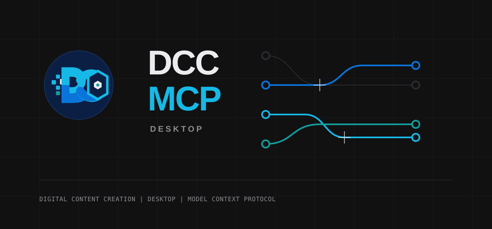

# dcc-mcp-desktop



Cross-platform desktop control plane for the `dcc-mcp` gateway. The client uses Tauri v2, React, TypeScript, and a Rust shell for tray behavior, gateway lifecycle, and local provisioning.

## Brand assets

- [Desktop mark](public/branding/dcc-mcp-desktop-mark.svg) for the app icon, favicon, and avatar surfaces.
- [Light web lockup](public/branding/dcc-mcp-desktop-lockup.svg) and [dark web lockup](public/branding/dcc-mcp-desktop-lockup-dark.svg) for product headers.
- [Social card](docs/assets/dcc-mcp-desktop-social.svg) for square social media posts.

## Development

This repository uses `vx` for toolchain management and `just` as the single task runner:

```powershell
vx setup
vx just dev
```

Run `vx just --list` to see all available tasks.

## Release scope

The first release is a Tauri v2 desktop shell around the real `dcc-mcp` gateway:

- Bundled `dcc-mcp-server` and `dccmcp` sidecars from independent Core and CLI releases, pinned by SHA-256 in `config/sidecars.json`.
- Rust-owned gateway lifecycle with start, stop, restart, readiness probe, bounded logs, and exit cleanup.
- An existing gateway on `127.0.0.1:9765` is adopted instead of being replaced.
- Typed Tauri commands and a real HTTP/SSE client using the core gateway routes.
- Main window, 380 × 540 tray quick panel, routing graph, and live call stream.
- Windows NSIS/MSI, macOS DMG, and Linux AppImage/DEB release pipelines.

The sidecar binaries are downloaded and verified by CI into `src-tauri/binaries/` before every desktop build. Local development can prepare them with the target-specific recipes listed by `vx just --list`.

Supported targets are `x86_64-pc-windows-msvc`, `aarch64-apple-darwin`, `x86_64-apple-darwin`, and `x86_64-unknown-linux-gnu`.

## Validation

```powershell
vx just test
vx just build
vx just lint
vx just check-versions
```

Installer builds require the native WebKitGTK and packaging dependencies listed in `.github/workflows/release.yml`.
